[](https://www.codacy.com/gh/semhoun/slim-tracy/dashboard?utm_source=github.com&utm_medium=referral&utm_content=semhoun/slim-tracy&utm_campaign=Badge_Grade)[](https://packagist.org/packages/semhoun/slim-tracy)
[](https://packagist.org/packages/semhoun/slim-tracy)
[](https://packagist.org/packages/semhoun/slim-tracy)
[](https://packagist.org/packages/semhoun/slim-tracy)
[](https://packagist.org/packages/semhoun/slim-tracy)
[](https://deepwiki.com/semhoun/slim-tracy)

# Slim Framework 4 Tracy Debugger Bar

configure it by mouse

---


now in package:

---

**Slim Framework**

- Slim Environment: RAW data
- Slim Container: RAW data
- Slim Request: RAW data
- Slim Response: RAW data
- Slim Router: RAW data

**DB**

- Doctrine [ORM](https://github.com/doctrine/doctrine2) or
  [DBAL](https://github.com/doctrine/dbal): time, sql, params, types. Panel &
  collector for both. **Note:** Need a Configuration instance available in DI,
  and must be the same used by Doctrine.
- [Illuminate Database](https://github.com/illuminate/database): sql, bindings

**Template**

- [Twig](https://github.com/twigphp/Twig):
  `\Twig\Profiler\Dumper\HtmlDumper()`

**Common**

- PanelSelector: easy configure (part of fork from
  [TracyDebugger](https://github.com/adrianbj/TracyDebugger))
- PhpInfo: full phpinfo()
- Console: PTY (pseudo TTY) console (fork from
  [web-console](https://github.com/nickola/web-console))
- Profiler: time, mem usage, timeline (fork from
  [profiler](https://github.com/netpromotion/profiler))
- Included Files: Included Files list
- XDebug: start and stop a Xdebug session (fork from
  [Nette-XDebug-Helper](https://github.com/jsmitka/Nette-XDebug-Helper))
- VendorVersions: version info from composer.json and composer.lock (fork from
  [vendor-versions](https://github.com/milo/vendor-versions))

---

# API Migration

This update supports PHP 8.2 through 8.5 and introduces breaking API changes.
Classes marked `final` must be composed rather than extended.

The global debugging helpers are replaced by autoloaded methods:

- Replace `tdie($value)` with `SlimTracy\Debug::dumpAndExit($value)`.
- Replace `ttimer($name)` with `SlimTracy\Debug::timer($name)`.
- Replace `cl($value)` with `SlimTracy\Debug::console($value)`.
- Replace `cl($value, 'warn')` with
  `SlimTracy\Debug::console($value, SlimTracy\ConsoleLevel::Warn)`.

Browser console output now rejects invalid JSON and escapes values that could
close its script element. Console levels are `ConsoleLevel::Log`, `Info`,
`Warn`, and `Error`.

Profile measurements are read through methods rather than public properties:
`metadata()`, `absoluteDuration()`, `duration()`, `absoluteMemoryUsageChange()`,
and `memoryUsageChange()`. Replace `setPostProcessor($callback)` with
`enable(false, $callback)`. Each `enable()` call starts a fresh profiling
session; use `enable(true)` instead of `enable(1)`. `EmptyStackException` is
renamed to `EmptyStack`; the singleton trait and interface have been removed.
`ProfilerService::getInstance()` and `hasInstance()` remain available.

The console controller now uses composition and receives a PSR-7
`ServerRequestInterface`. Custom integrations with `WebConsoleRPCServer`
configure accounts, authentication, and directories through its constructor.
Pass the raw JSON body to `execute($rawBody)` instead of populating HTTP
globals. The low-level console no longer emits HTTP headers; the PSR-7
controller handles them. Only public application methods are callable by
JSON-RPC.

# Install

## AJAX/API Profiling Migration

Native Tracy AJAX tracking is removed, including when the new profiler is
disabled. There is no fallback to native interception and no generated
`X-Tracy-Ajax` header. The existing HTML bar, panels, and error handling remain
available. Tracy is pinned to the tested 2.12.2 internal asset and isolated-bar
integration.

**Development only: every stored profile is shared, without authentication or
user/session isolation.** Anyone who can reach this server can read its SQL
profiles. Do not expose this mode on the Internet. Isolate the development
network. CORS is not authentication and does not restrict non-browser clients.

Pass the `tracy` settings subsection itself, not its parent settings object:

```php
use SlimTracy\Middlewares\TracyMiddleware;
use SlimTracy\Profiling\Configuration;
use SlimTracy\Profiling\Routes;
use Tracy\Debugger;

$tracySettings['configs']['Debugger']['mode'] = Debugger::Development;
$tracySettings['configs']['AjaxProfiler'] = [
    'enabled' => true, // Strict boolean; false by default.
    'origins' => ['http://localhost:5173'], // Exact incoming frontend origins.
    'path' => '/_tracy/api',
    // Outside the web root.
    'storageDirectory' => $applicationRoot . '/var/tmp/api-profiles',
    'ttl' => 600,
    'maxProfiles' => 100,
    'maxProfileBytes' => 262144,
    'maxTotalBytes' => 10485760,
];

// Add Slim routing/error middleware first.
// Slim executes middleware last-added first.
$app->addRoutingMiddleware();
// Keep your application's JSON error renderer.
$app->addErrorMiddleware(false, true, true);
$app->add(new TracyMiddleware($app, $tracySettings));
$configuration = Configuration::fromSettings($tracySettings);
Routes::register($app, $configuration);
```

Construct the middleware before any `Debugger::enable()` that could dispatch
Tracy assets. If mounted below a URL prefix, call `$app->setBasePath()` before
constructing the middleware. Choose the debugger mode from trusted application
configuration, never from request input. Activation requires `enabled === true`
and resolved `Debugger::$productionMode === false`. Disabled or production
requests cannot read residual profiles. `ShowBar=false` does not disable active
server collection. The writable host container must support `set()`. Build
Doctrine connections after middleware collector registration. API collection
ignores panel-selection cookies. Eloquent requires the host to enable its query
log.

- `GET /_tracy/api`: direct, unauthenticated debug page with only the API panel.
- `GET /_tracy/api/profiles?after=<cursor>&limit=50`: incremental shared history,
  `profiles` and `nextCursor`.
- `GET /_tracy/api/profiles/{id}`: versioned structured server snapshot.
- `POST /_tracy/api/browser`: bounded JSON client-reported timing for a
  server-issued profile ID.

Responses use `Cache-Control: no-store`. Application responses retain their
body/status and receive `X-SlimTracy-Profile` for correlation. An escaping
exception is rethrown with an unknown snapshot status; only errors handled
inside Slim reliably retain a correlation response header. Debug routes,
telemetry, assets, and OPTIONS requests are excluded from collection.

For a cross-origin SPA, configure the host API CORS middleware for its
application routes too. Expose `X-SlimTracy-Profile`, allow the application's
actual request headers/methods, and preserve `Vary: Origin`. The profiler's
exact-origin CORS policy covers its own routes only. Put host CORS outermost,
but do not short-circuit profiler preflights or overwrite its policy. No
third-party cookies or credentials changes are required.

### Twig, React and Vue

HTML/Twig pages receive the common client through Tracy's assets when profiling
is active. Load Tracy before application API calls you want observed; the
initial document load is not a fetch entry. For a separately hosted SPA, bundle
the independent `packages/ajax-profiler` package and initialize before API
calls:

```js
import { install } from "@slim-tracy/ajax-profiler";

const client = install({
  enabled: import.meta.env.DEV && profilingEnabled, // Host-controlled opt-in.
  baseUrl: "http://localhost:8080/_tracy/api",
  // Outgoing API destinations, not frontend origins.
  allowedOrigins: ["http://localhost:8080"],
});

// React uses this common client only, not a React DevTools plugin.
if (import.meta.hot) import.meta.hot.dispose(() => client.stop());
```

For Vue 3, add the optional public Devtools adapter to the same client and app:

```js
import { installVueDevtools } from "@slim-tracy/ajax-profiler/vue";

const adapter = installVueDevtools(app, client);
app.mount("#app");
if (import.meta.hot) import.meta.hot.dispose(() => adapter.stop());
```

Vue uses the public `@vue/devtools-api` v6 plugin API for its timeline and
inspector. The browser profiler baseline is Chrome 87+, Firefox 78+, Safari 14+,
and Edge 88+, based on required APIs such as `replaceChildren`, `globalThis`,
and `AbortController`. Automated browser tests run only in Chromium; the
Firefox, Safari, and Edge baselines indicate API compatibility, not tested
coverage. Imports are SSR-safe; install the browser client only in the browser.
No Node SSR renderer is provided. Open the backend debug page in a separate tab;
do not inject Tracy into a cross-origin SPA. Permit the backend origin in the
SPA's CSP `connect-src` and your bundled client in `script-src`. Tracy HTML
additionally needs its own scripts/styles and nonce handling under strict CSP;
do not weaken a production CSP to enable this development feature.

Server duration, browser duration, and SQL duration are milliseconds; memory is
bytes. Fetch duration ends at response headers without consuming its
body/stream; XHR duration ends at `loadend`. These are not identical
full-transfer measurements. Never subtract client and server clocks. Browser
timings are untrusted client reports, not server measurements. Network
failures/aborts without a response remain local and have no invented server
profile. Missing collectors differ from empty measurements. Bodies, query
strings, cookies, authorization, and SQL parameter values are not exported by
default. **Raw SQL can still contain sensitive literals.** Supply
`configs.AjaxProfiler.sqlFilter`, a host callback
`fn (string $sql): string => ...`, to redact SQL text; omitted bindings do not
anonymize SQL. Storage is temporary and bounded, with truncation markers; it is
not a durable audit log. Persistent PHP worker/global-state compatibility is not
guaranteed. Ordinary API traffic uses stateless native storage to avoid Tracy's
cookie lock; HTML deferred loading is retained. Preinitialized host-provided
Tracy storage owns its locking behavior. Requests explicitly advertising an HTML
document may retain native HTML session behavior; construct this integration
before Tracy initialization.

**1.**

```bash
$ composer require semhoun/slim-tracy
```

**2.** goto 3 or if need Twig, Doctrine DBAL, Doctrine ORM, Eloquent ORM then:

**2.1** install it

```bash
$ composer require doctrine/dbal
$ composer require doctrine/orm
$ composer require slim/twig-view
$ composer require illuminate/database
```

**2.2** add to your dependencies

**2.2.1** (Twig, Twig_Profiler) and/or Eloquent ORM like:

```php
// Twig
return [
    Twig::class => static function (
        Settings $settings,
        \Twig\Profiler\Profile $profile
    ): Twig {
        $view = Twig::create(
            $settings->get('view.template_path'),
            $settings->get('view.twig')
        );
        if ($settings->get('debug')) {
            // Add extensions
            $view->addExtension(
                new \Twig\Extension\ProfilerExtension($profile)
            );
            $view->addExtension(new \Twig\Extension\DebugExtension());
        }
        return $view;
    },

    // Doctrine DBAL and ORM
    \Doctrine\DBAL\Connection::class => static function (
        Settings $settings,
        Doctrine\ORM\Configuration $conf
    ): Doctrine\DBAL\Connection {
        return \Doctrine\DBAL\DriverManager::getConnection(
            $settings->get('doctrine.connection'),
            $conf
        );
    },
    // Doctrine Config used by entity manager and Tracy
    \Doctrine\ORM\Configuration::class => static function (
        Settings $settings
    ): Doctrine\ORM\Configuration {
        if ($settings->get('debug')) {
            $queryCache = new ArrayAdapter();
            $metadataCache = new ArrayAdapter();
        } else {
            $queryCache = new PhpFilesAdapter(
                'queries', 0, $settings->get('cache_dir')
            );
            $metadataCache = new PhpFilesAdapter(
                'metadata', 0, $settings->get('cache_dir')
            );
        }

        $config = new \Doctrine\ORM\Configuration();
        $config->setMetadataCache($metadataCache);
        $driverImpl = new \Doctrine\ORM\Mapping\Driver\AttributeDriver(
            $settings->get('doctrine.entity_path'),
            true
        );
        $config->setMetadataDriverImpl($driverImpl);
        $config->setQueryCache($queryCache);
        $config->setProxyDir($settings->get('cache_dir') . '/proxy');
        $config->setProxyNamespace('App\Proxies');

        if ($settings->get('debug')) {
            $config->setAutoGenerateProxyClasses(true);
        } else {
            $config->setAutoGenerateProxyClasses(false);
        }

        return $config;
    },
    // Doctrine EntityManager.
    EntityManager::class => static function (
        \Doctrine\ORM\Configuration $config,
        \Doctrine\DBAL\Connection $connection
    ): EntityManager {
        return new EntityManager($connection, $config);
    },
	EntityManagerInterface::class => DI\get(EntityManager::class),
]
```

**2.2.2** Eloquent ORM like:

```php
// Register Eloquent single connection
$capsule = new \Illuminate\Database\Capsule\Manager;
$capsule->addConnection($cfg['settings']['db']['connections']['mysql']);
$capsule->setAsGlobal();
$capsule->bootEloquent();
$capsule::connection()->enableQueryLog();

```

**3.** register middleware If param `['configs']['Debugger']` is setted, also
enable Tracy\Debugger.

```php
$app->add(new SlimTracy\Middlewares\TracyMiddleware($app, $tracySettings));
```

**4.** register route if you plan use PTY Console

```php
$app->post('/console', 'SlimTracy\Controllers\SlimTracyConsole:index');
```

also copy you want `jquery.terminal.min.js` & `jquery.terminal.min.css` from
`vendor/semhoun/slim-tracy/web` and correct path in 'settings' below, or set
config with CDN.

```php
'ConsoleTerminalJs' => 'https://cdnjs.cloudflare.com/ajax/libs/'
    . 'jquery.terminal/2.42.2/js/jquery.terminal.min.js',
'ConsoleTerminalCss' => 'https://cdnjs.cloudflare.com/ajax/libs/'
    . 'jquery.terminal/2.42.2/css/jquery.terminal.min.css',
```

add jquery from local or from CDN (https://code.jquery.com/) or copy/paste

```html
<script
  src="https://code.jquery.com/jquery-3.7.1.min.js"
  integrity="sha256-/JqT3SQfawRcv/BIHPThkBvs0OEvtFFmqPF/lYI/Cxo="
  crossorigin="anonymous"
></script>
```

**5.** add to your settings Debugger initialisation and 'tracy' section.

```php
use Tracy\Debugger;

return [
    'settings' => [
                // Debugbar possibly not working with true.
                'addContentLengthHeader' => false
    ... // ...
    ... // ...

        'tracy' => [
            'showPhpInfoPanel' => 0,
            'showSlimRouterPanel' => 0,
            'showSlimEnvironmentPanel' => 0,
            'showSlimRequestPanel' => 1,
            'showSlimResponsePanel' => 1,
            'showSlimContainer' => 0,
            'showEloquentORMPanel' => 0,
            'showTwigPanel' => 0,
            'showDoctrinePanel' => 0,
            'showProfilerPanel' => 0,
            'showVendorVersionsPanel' => 0,
            'showXDebugHelper' => 0,
            'showIncludedFiles' => 0,
            'showConsolePanel' => 0,
            'configs' => [
                // Show bar (mainly for disable bar)
                'ShowBar' => 1
                // XDebugger IDE key
                'XDebugHelperIDEKey' => 'PHPSTORM',
                 // Activate the console
                 'ConsoleEnable' => 1,
                 // Disable login (don't ask for credentials, be careful).
                 // Values: 1 || 0.
                'ConsoleNoLogin' => 0,
                 // Multi-user credentials, e.g.
                 // ['user1' => 'password1', 'user2' => 'password2'].
                'ConsoleAccounts' => [
                     // = sha1('dev')
                     'dev' => '34c6fceca75e456f25e7e99531e2425c6c1de443'
                ],
                 // Password hash algorithm (password must be hashed).
                 // Values: 'md5', 'sha256', ...
                'ConsoleHashAlgorithm' => 'sha1',
                 // Home directory (multi-user mode supported): var || array.
                 // '' || '/tmp' ||
                 // ['user1' => '/home/user1', 'user2' => '/home/user2']
                'ConsoleHomeDirectory' => DIR,
                // terminal.js full URI
                'ConsoleTerminalJs' => '/assets/js/jquery.terminal.min.js',
                // terminal.css full URI
                'ConsoleTerminalCss' => '/assets/css/jquery.terminal.min.css',
                'ConsoleFromEncoding' => 'CP866', // or false
                'ProfilerPanel' => [
                     // Memory usage 'primaryValue' set as Profiler::enable()
                     // or Profiler::enable(true).
                     // 'primaryValue' => 'effective', // or 'absolute'
                    'show' => [
                        'memoryUsageChart' => 1, // or false
                        'shortProfiles' => true, // or false
                        'timeLines' => true // or false
                    ]
                ],
                'Container' => [
                // Container entry name
                     // Must be a DBAL or ORM configuration.
                     'Doctrine' => \Doctrine\ORM\Configuration::class,
                    'Twig' => \Twig\Profiler\Profile::class,
                ],
                'Debugger' => [
                  // See \Tracy\Debugger::enable
                  'mode' => Debugger::Development,
                  'logDirectory' => null,
                  'email' => null
                ],
            ]
        ]
```

See [configuration examples](examples/settings.php) and
[middleware registration](examples/middleware.php). These are host-application
snippets, not a runnable demo: they reference external `App\` services and
configuration.

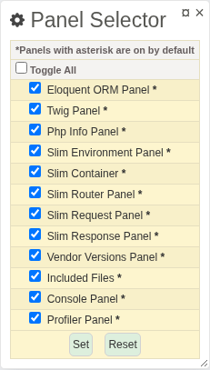

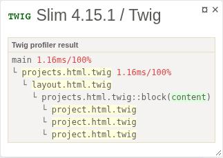

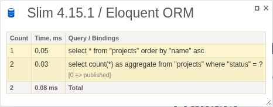

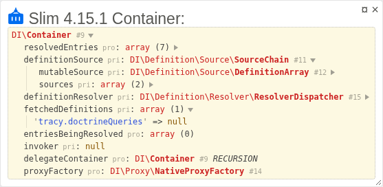

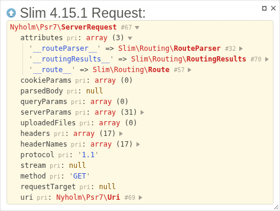

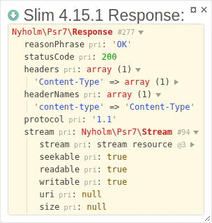

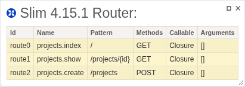

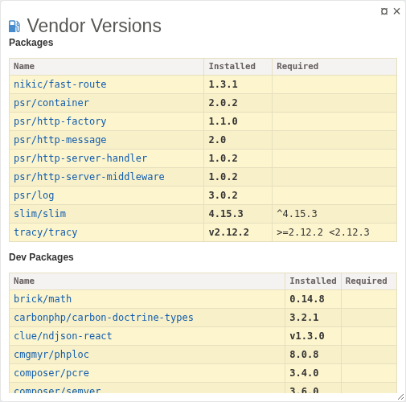

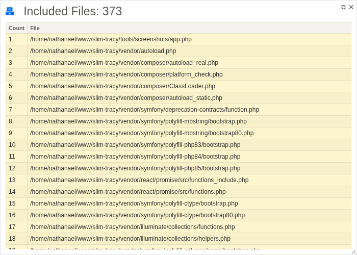

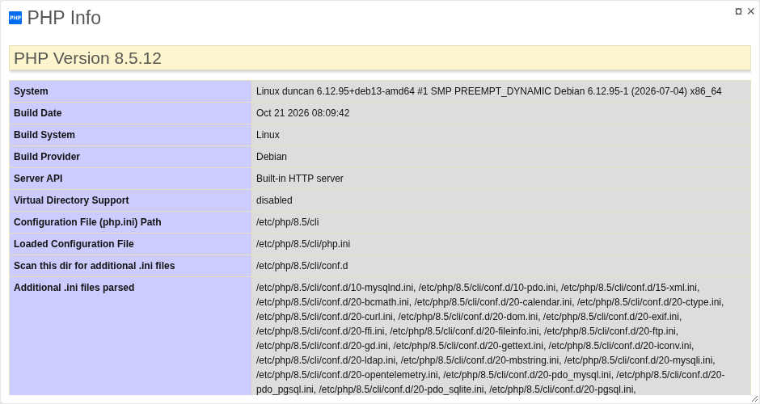

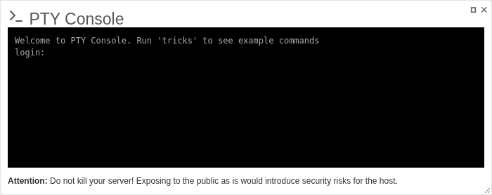

Profiler Example in
[slim-skeleton-mvc](https://github.com/semhoun/slim-skeleton-mvc)
`public/index.php`

```php
<?php
use App\Services\Settings;
use DI\ContainerBuilder;

// Set the absolute path to the root directory.
$rootPath = realpath(__DIR__ . '/..');

// Include the composer autoloader.
include_once $rootPath . '/vendor/autoload.php';

SlimTracy\Helpers\Profiler\Profiler::enable();
SlimTracy\Helpers\Profiler\Profiler::start('App');

// The container has not been built. Load the settings manually.
SlimTracy\Helpers\Profiler\Profiler::start('loadSettings');
$settings = Settings::load();
SlimTracy\Helpers\Profiler\Profiler::finish('loadSettings');

// DI Builder
$containerBuilder = new ContainerBuilder();

if (! $settings->get('debug')) {
    // Compile and cache container.
    $containerBuilder->enableCompilation(
        $settings->get('cache_dir').'/container'
    );
}

// Set up dependencies
SlimTracy\Helpers\Profiler\Profiler::start('initDeps');
$containerBuilder->addDefinitions($rootPath.'/config/dependencies.php');
SlimTracy\Helpers\Profiler\Profiler::finish('initDeps');

// Build PHP-DI Container instance
 SlimTracy\Helpers\Profiler\Profiler::start('diBuild');
$container = $containerBuilder->build();
SlimTracy\Helpers\Profiler\Profiler::finish('diBuild');

// Instantiate the app
$app = \DI\Bridge\Slim\Bridge::create($container);

// Register middleware
SlimTracy\Helpers\Profiler\Profiler::start('initMiddleware');
$middleware = require $rootPath . '/config/middleware.php';
$middleware($app);
SlimTracy\Helpers\Profiler\Profiler::finish('initMiddleware');

// Register routes
SlimTracy\Helpers\Profiler\Profiler::start('initRoutes');
$routes = require $rootPath . '/config/routes.php';
$routes($app);
SlimTracy\Helpers\Profiler\Profiler::finish('initRoutes');

// Set the cache file for the routes. Note that you have to delete this file
// whenever you change the routes.
if (! $settings->get('debug')) {
    $app->getRouteCollector()->setCacheFile(
        $settings->get('cache_dir').'/route'
    );
}

// Add the routing middleware.
$app->addRoutingMiddleware();

// Add Body Parsing Middleware
$app->addBodyParsingMiddleware();

// Run the app
$app->run();
SlimTracy\Helpers\Profiler\Profiler::finish('App');

```

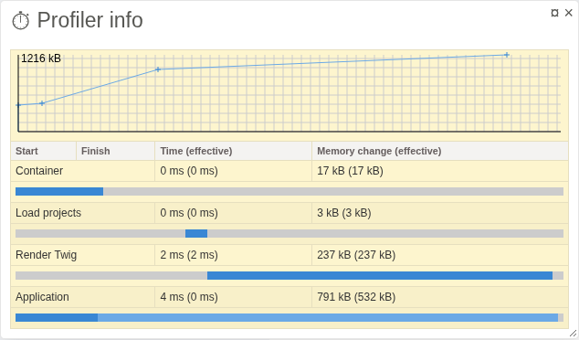

---

## Tests

```bash
composer install
composer test
composer rector-check
composer insights-check
npm ci
npm --prefix packages/ajax-profiler ci
npx playwright install chromium
npm run test:js
npm run test:browser
npm run check
```

Run from this repository root with PHP 8.2-8.5 and Node.js 22+. Browser tests
start real Slim/Tracy HTTP fixtures on ports 8781-8784 and build framework
fixtures into temporary storage. They mount React and Vue, exercise real
cross-origin fetch/XHR, and use a public Vue Devtools API test bridge. The
bridge is not an installed Devtools extension test. Browser coverage uses
Chromium, not every browser engine.

## Credits

- [https://github.com/runcmf/runtracy](https://github.com/runcmf/runtracy)
- [https://github.com/semhoun/slim-tracy](https://github.com/semhoun/slim-tracy)

---

## License

```bash
Copyright 2016-2022 1f7.wizard@gmail.com.
Copyright 2024 Nathanaël Semhoun (nathanael@semhoun.net).

Licensed under the Apache License, Version 2.0 (the "License");
you may not use this file except in compliance with the License.
You may obtain a copy of the License at

    http://www.apache.org/licenses/LICENSE-2.0

Unless required by applicable law or agreed to in writing, software
distributed under the License is distributed on an "AS IS" BASIS,
WITHOUT WARRANTIES OR CONDITIONS OF ANY KIND, either express or implied.
See the License for the specific language governing permissions and
limitations under the License.
```
